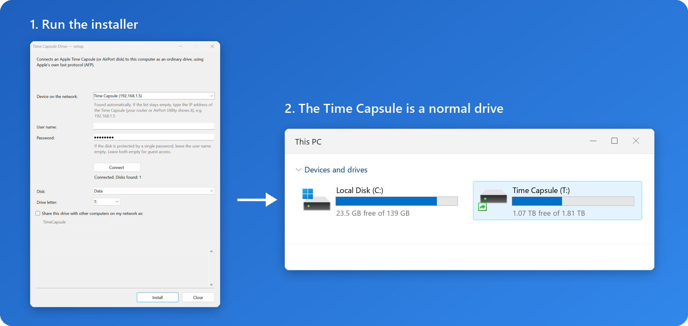
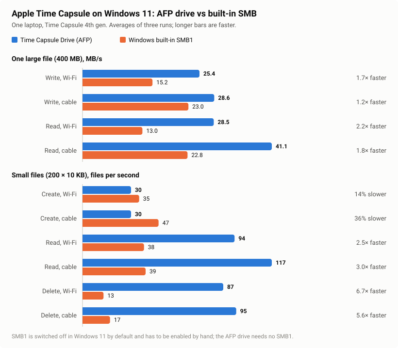
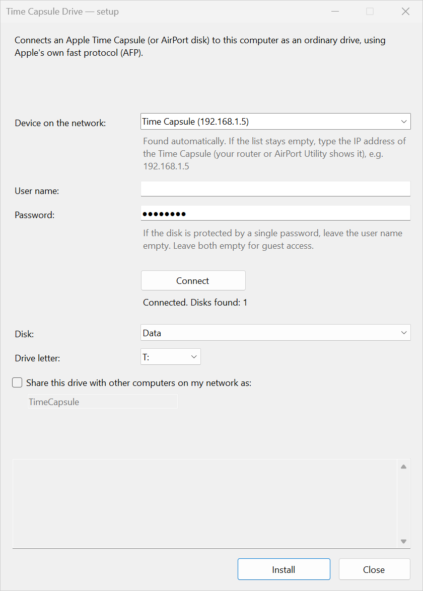

# Time Capsule Drive

**English** | [Русский](README.ru.md)

**Use an Apple Time Capsule on Windows 10/11 as a normal drive. No SMB1, and nothing to change on the Time Capsule.**

[](https://github.com/Steklorez/time-capsule-windows/releases/latest)
[](https://github.com/Steklorez/time-capsule-windows/releases)
[](LICENSE)



### [⬇ Download TimeCapsuleDriveSetup.exe](https://github.com/Steklorez/time-capsule-windows/releases/latest/download/TimeCapsuleDriveSetup.exe)

<div align="center">


### ☕ Enjoying Time Capsule Drive? Consider buying the author a cup of coffee!

[](https://ko-fi.com/I3I0273OYI)
[](https://boosty.to/steklorez)

<a href="https://ko-fi.com/I3I0273OYI"></a>&nbsp;&nbsp;&nbsp;&nbsp;<a href="https://boosty.to/steklorez"></a>


</div>

Free and open source. Windows 10/11 x64. One file, nothing else to install.

## The problem it solves

Windows can only open a Time Capsule through SMB1, an old protocol that Windows 11 ships switched off. That is
why you see *"You can't connect to the file share because it's not secure. This share requires the obsolete
SMB1 protocol"* or *"Windows cannot access \\\\…"* (error 0x80070035).

Time Capsule Drive talks to the Time Capsule the way a Mac does, over Apple's own protocol (AFP), and shows it
as a drive letter.

- **No SMB1.** Leave it switched off.
- **Faster.** Large files read 1.8–2.2× faster than over SMB1 (measurements below).
- **The Time Capsule is not touched.** No firmware changes, nothing installed on it. Macs keep using it as before.
- **Set up once.** The drive comes back by itself every time Windows starts, and reconnects after a network drop.
- **Can serve the whole house.** One PC can share the drive, so other computers need nothing installed.

> **Early release.** Tested on one device, a Time Capsule 4th generation (2011). Keep a second copy of anything
> important, and please [report](https://github.com/Steklorez/time-capsule-windows/issues/new/choose) how it
> works on your model.

## Speed

<picture>
  <source media="(prefers-color-scheme: dark)" srcset="docs/speed-en-dark.svg">
  
</picture>

Reading and deleting are much faster, writing a large file is somewhat faster, and creating many small files is
currently slower than SMB1.

<details>
<summary>All numbers and how they were measured</summary>

Over Wi-Fi:

| | Windows built-in SMB1 | Time Capsule Drive (AFP) | Difference |
|---|---:|---:|---|
| Large file, write | 15.2 MB/s | 25.4 MB/s | 1.7× faster |
| Large file, read | 13.0 MB/s | 28.5 MB/s | 2.2× faster |
| Small files, create | 35 per second | 30 per second | 14% slower |
| Small files, read | 38 per second | 94 per second | 2.5× faster |
| Small files, delete | 13 per second | 87 per second | 6.7× faster |

Over a network cable:

| | Windows built-in SMB1 | Time Capsule Drive (AFP) | Difference |
|---|---:|---:|---|
| Large file, write | 23.0 MB/s | 28.6 MB/s | 1.2× faster |
| Large file, read | 22.8 MB/s | 41.1 MB/s | 1.8× faster |
| Small files, create | 47 per second | 30 per second | 36% slower |
| Small files, read | 39 per second | 117 per second | 3.0× faster |
| Small files, delete | 17 per second | 95 per second | 5.6× faster |

How it was measured: one Windows 11 laptop, Time Capsule 4th generation, a 400 MB file and 200 files of 10 KB,
Windows' own cache bypassed, averages of three runs of each test (`tools/speed-compare.ps1`); for the cable run
the laptop was on battery. One computer and one device: a guide, not a guarantee. Run the script yourself to see
your numbers.

On another PC over gigabit cable the same drive writes at 31–34 MB/s and reads from 45 MB/s (a file just written)
up to 90 MB/s (a file that has been on the disk for a while), which is the limit of the Time Capsule itself.

The charts are drawn by `docs/make-speed-chart.py`.

</details>

## Install



Run `TimeCapsuleDriveSetup.exe` and confirm the administrator prompt.

1. **Device on the network** is found automatically. If the list stays empty, type the IP address.
2. **User name and password** as set on the Time Capsule. For a disk password leave the user name empty; for
   guest access leave both empty.
3. Pick a **drive letter**.
4. Press **Install**.

The drive appears at once.

**Windows SmartScreen will warn about the file** because it is not code-signed: choose "More info" → "Run
anyway". The SHA-256 of each release is on the
[Releases](https://github.com/Steklorez/time-capsule-windows/releases) page.

**To change settings or uninstall**, run the setup program again, or use Windows "Apps".

**If the drive is gone**, open the setup window: the line at the top says whether it is connected and, if not,
why. If the Time Capsule gets a new IP address, the program finds it by name on its own.

<br clear="right">

### One computer or the whole network

- **On every computer:** install on each PC. Each one talks to the Time Capsule directly; this is the fastest.
- **One bridge computer:** on one PC tick **Share this drive with other computers**. The others open
  `\\bridge\TimeCapsule` as a normal network folder and install nothing.

## Which way is right for you

| | Switch SMB1 back on | [TimeCapsuleSMB](https://github.com/jamesyc/TimeCapsuleSMB) | Time Capsule Drive |
|---|---|---|---|
| What it is | A Windows setting | Modern Samba installed on the Time Capsule | A program on the Windows PC |
| Changes on the Time Capsule | None | Yes; generations 1–4 also need a firmware patch to start it after a reboot | None |
| SMB1 on your PC | Required | Not needed | Not needed |
| Time Machine on macOS 27+ | No | Yes | No |
| Best for | Not recommended | Mac owners | Windows owners |

If you back up Macs with macOS 27 or later, you need TimeCapsuleSMB. If you only want the disk on Windows and
would rather leave the device alone, this program is the simpler way.

## Tested devices

| Device | Status |
|---|---|
| Time Capsule 4th generation (A1409, 2011) | Works; all development and tests were done on it |
| Time Capsule 5th generation (A1470, 2013) | Not tested yet |
| Time Capsule 1st–3rd generation | Not tested yet |
| AirPort Extreme with a USB disk | Not tested yet |

Tried it on another model?
[Send a compatibility report](https://github.com/Steklorez/time-capsule-windows/issues/new?template=compatibility.yml);
it takes a minute and helps everyone with the same device.

## Good to know

- Meant for your home network: AFP does not verify the server, so do not use it on public networks.
- One installation mounts one disk of one Time Capsule.
- Do not write inside Time Machine backups.
- Mac-only metadata (Finder labels, resource forks of old files) is not visible on Windows.
- The disk of the Time Capsule goes to sleep; the first access after a pause takes about 8 seconds.

<details>
<summary><b>Data safety: what was tested</b></summary>

Verified on a Time Capsule 4th generation (the `selftest` command and the test scripts):

- **One writer at a time.** A file open for writing cannot be opened for writing by another computer
  ("file in use"); reading it is still allowed.
- **Lost connection.** The program reconnects, the server discards the old session, open files are reopened and
  carry on. Tested under load with the connection cut every few seconds: large and small files arrived intact.
- **Crash of the program or the computer.** On the next start the server closes whatever the previous run left
  open. Without this the Time Capsule keeps such files locked for about seven minutes.
- **Flush means flush.** An application's "write to disk now" request is passed to the server as a real
  commit to the disk.
- **Replacing a file.** When a file is saved over an existing one, the old file is moved aside first and
  removed only after the new one is in place.
- **Large and many.** A 4.3 GB file, three copies at once, 600 files in a row: no errors.

How writes are confirmed: a large write returns to the application only after the server has acknowledged it.
Small writes (under 128 KB) are gathered into bigger pieces first, which is what makes copying with small buffers
fast; they are sent within about two seconds, or when the file is read, flushed or closed. If saving such data
fails, the application is told on its next operation on the file; if the failure happens at close, it is only
written to the log. A full disk is checked for in advance.

Implemented from the protocol documentation but not exercised on a live device:

- **Sleep.** Before the computer sleeps, pending data is written and the server is told the client is asleep.
- **Silent connection.** Two minutes without anything from the server counts as a lost connection (the server
  normally sends a keep-alive every 30 seconds).
- **Server messages** about shutdown and about changes on the disk (the latter refresh the file list).

</details>

<details>
<summary><b>All known limitations</b></summary>

- After the connection is cut in the middle of a write, the first reconnect can take up to two minutes; the
  drive pauses meanwhile and then continues.
- With guest access (no user name and password) a file that was open for writing may stay locked for up to
  seven minutes after a lost connection; the server's behaviour for guests has not been verified.
- One installation mounts one disk of one Time Capsule.
- AFP does not authenticate the server. The program connects to the device by address and, if it does not answer
  there, looks on the local network for a device with the same name and model. On someone else's or a public
  network that can be abused, so this is meant for your home network.
- Mac metadata (Finder labels, resource forks of old files) is invisible to Windows and is not carried over when
  Windows copies a file. Moving and renaming inside the disk keep it.
- Byte-range locks are not shared between computers (only whole-file write protection is).
- Do not write inside Time Machine backups.
- If the Time Capsule was unreachable when you signed in to Windows and connects later, Explorer may not show
  the drive until Explorer is restarted.

</details>

<details>
<summary><b>What the installer puts on the computer</b></summary>

Nothing is downloaded: .NET and the official WinFsp installer are inside the file.

| What | Where |
|---|---|
| Program | `C:\Program Files\TimeCapsuleDrive\` (`TimeCapsuleDrive.exe`, `winfsp-msil.dll`) |
| Settings (password encrypted, administrators only) | `C:\ProgramData\TimeCapsuleDrive\config.txt` |
| Log (everyone may read, only administrators may change) | `C:\ProgramData\TimeCapsuleDrive\timecapsule.log` |
| Start with Windows | scheduled task `TimeCapsuleDrive` (runs as SYSTEM at boot) |
| Sharing (if chosen) | a network share with full access (sign in with an account of that computer) and the firewall rule "TimeCapsuleDrive file sharing (SMB-In)": port 445 for the local subnet on private networks. The rule opens file sharing for the whole computer, not only for this share |
| Drive component | WinFsp (left in place on uninstall: other programs may use it) |

</details>

<details>
<summary><b>Command line</b></summary>

```
TimeCapsuleDrive                      setup window
TimeCapsuleDrive install --config F   install without a window, settings from file F  [--share NAME]
TimeCapsuleDrive uninstall [--silent] uninstall
TimeCapsuleDrive stop                 stop the drive (until Windows starts again)
TimeCapsuleDrive probe | ls | selftest | bench | benchw | mount     diagnostic tools
```

The settings file holds `key=value` lines: `host`, `volume`, `login`, `password`, `drive`, `share`.
During development the program reads `credentials.txt` from the project folder (never committed).

</details>

<details>
<summary><b>Building and how it works</b></summary>

Needs the .NET 10 SDK. Run `build.cmd`; the result is `dist\TimeCapsuleDriveSetup.exe`, one file that is both
the installer and the program.

- `src/TimeCapsuleDrive/Afp`: an AFP 3.3 client over TCP written for this project: DHX2 login, files, write
  protection, reconnect, server messages.
- `src/TimeCapsuleDrive/Fs`: the file system for WinFsp: read-ahead, gathered and pipelined writes.
- `src/TimeCapsuleDrive/Install`: the installer and the setup window.

Time Capsule quirks the code works around:

- creating, deleting and renaming only work when the target is given as "parent folder id + name";
- growing a file makes the Time Capsule fill it with zeros, so growth is postponed until the file is closed;
- its disk goes to sleep; the first access after a pause takes about 8 seconds.

</details>

## Questions and problems

- Something does not work: [open an issue](https://github.com/Steklorez/time-capsule-windows/issues/new/choose)
  and attach `C:\ProgramData\TimeCapsuleDrive\timecapsule.log`.
- Questions and ideas: [Discussions](https://github.com/Steklorez/time-capsule-windows/discussions).

If the program is useful to you, a ⭐ helps other Time Capsule owners find it.

## Licence

Time Capsule Drive is free software, released under the [GNU General Public License v3.0](LICENSE).

Dependencies:

- [WinFsp](https://winfsp.dev): GPLv3 with an exception for free and open-source software that permits both
  linking and redistributing the unmodified installer. The WinFsp 2.2 installer is included as is
  (source: https://github.com/winfsp/winfsp, licence: `third_party/WinFsp-License.txt`).
- [BouncyCastle](https://www.bouncycastle.org/csharp/): MIT (the CAST5 cipher used by the login).

Apple, Time Capsule, AirPort and Time Machine are trademarks of Apple Inc. This project is not affiliated with
or endorsed by Apple.
