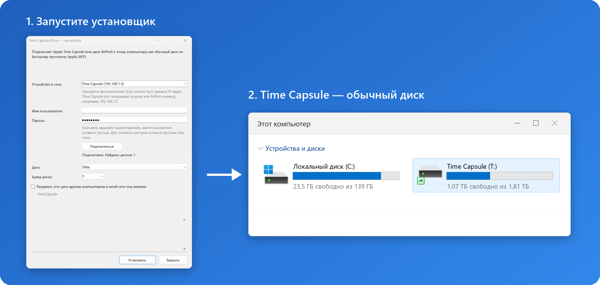
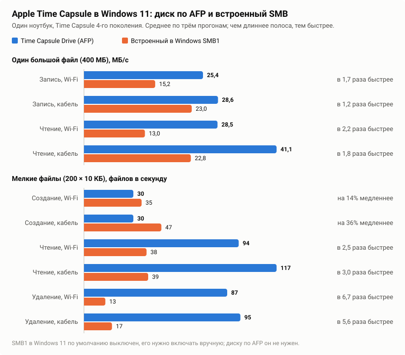
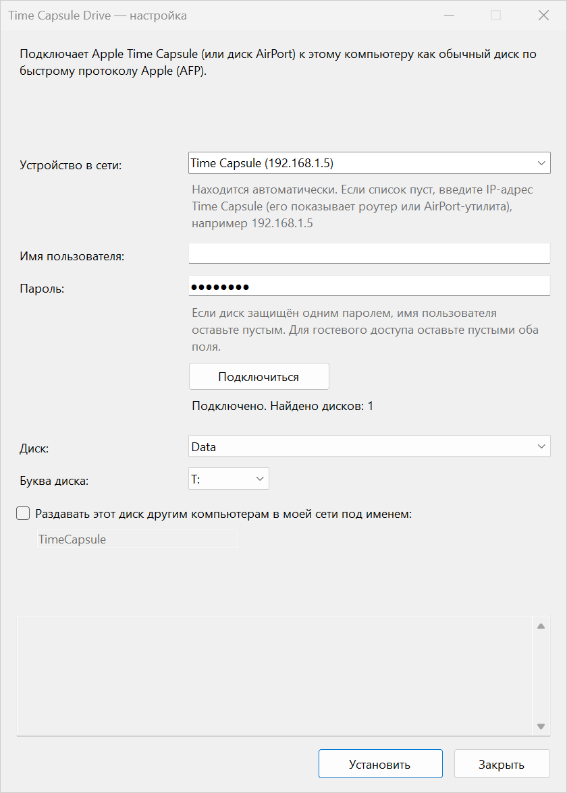

# Time Capsule Drive

[English](README.md) | **Русский**

**Apple Time Capsule как обычный диск в Windows 10/11. Без SMB1 и без изменений на самой Time Capsule.**

[](https://github.com/Steklorez/time-capsule-windows/releases/latest)
[](https://github.com/Steklorez/time-capsule-windows/releases)
[](LICENSE)
[](https://www.virustotal.com/gui/file/4edb05eac0643ec8322739ee075aa698738f2e57683c8f4c03a19ea893c6218d)



### [⬇ Скачать TimeCapsuleDriveSetup.exe](https://github.com/Steklorez/time-capsule-windows/releases/latest/download/TimeCapsuleDriveSetup.exe)

<div align="center">


### ☕ Нравится Time Capsule Drive? Поддержите автора — угостите кофе!

[](https://ko-fi.com/I3I0273OYI)
[](https://boosty.to/steklorez)

<a href="https://ko-fi.com/I3I0273OYI"></a>&nbsp;&nbsp;&nbsp;&nbsp;<a href="https://boosty.to/steklorez"></a>


</div>

Бесплатно, с открытым кодом. Windows 10/11 x64. Один файл, больше ничего ставить не нужно.

## Какую проблему решает

Windows умеет открывать Time Capsule только через SMB1. Это устаревший протокол, в Windows 11 он выключен.
Отсюда ошибки *«Вы не можете подключиться к общей папке, так как она небезопасна. Эта общая папка работает по
устаревшему протоколу SMB1»* и *«Windows не может получить доступ к \\\\…»* (ошибка 0x80070035).

Time Capsule Drive общается с Time Capsule так же, как Mac, по родному протоколу Apple (AFP), и показывает её
как диск с буквой.

- **Без SMB1.** Включать его не нужно.
- **Быстрее.** Большие файлы читаются в 1,8–2,2 раза быстрее, чем по SMB1 (замеры ниже).
- **Time Capsule остаётся как есть.** Прошивка не меняется, на неё ничего не ставится. Маки работают с ней как раньше.
- **Настроил и забыл.** Диск сам подключается при каждом запуске Windows и после обрыва сети.
- **Можно на весь дом.** Один компьютер раздаёт диск остальным, на них ничего ставить не нужно.

> **Ранний выпуск.** Проверено на одном устройстве: Time Capsule 4-го поколения (2011). Важные данные храните
> ещё где-нибудь и, пожалуйста, [напишите](https://github.com/Steklorez/time-capsule-windows/issues/new/choose),
> как программа работает на вашей модели.

## Скорость

<picture>
  <source media="(prefers-color-scheme: dark)" srcset="docs/speed-ru-dark.svg">
  
</picture>

Чтение и удаление намного быстрее, запись большого файла быстрее умеренно, создание множества мелких файлов
пока медленнее, чем по SMB1.

<details>
<summary>Все цифры и как они измерены</summary>

По Wi-Fi:

| | Встроенный в Windows SMB1 | Time Capsule Drive (AFP) | Разница |
|---|---:|---:|---|
| Запись большого файла | 15,2 МБ/с | 25,4 МБ/с | в 1,7 раза быстрее |
| Чтение большого файла | 13,0 МБ/с | 28,5 МБ/с | в 2,2 раза быстрее |
| Создание мелких файлов | 35 в секунду | 30 в секунду | на 14% медленнее |
| Чтение мелких файлов | 38 в секунду | 94 в секунду | в 2,5 раза быстрее |
| Удаление мелких файлов | 13 в секунду | 87 в секунду | в 6,7 раза быстрее |

По кабелю:

| | Встроенный в Windows SMB1 | Time Capsule Drive (AFP) | Разница |
|---|---:|---:|---|
| Запись большого файла | 23,0 МБ/с | 28,6 МБ/с | в 1,2 раза быстрее |
| Чтение большого файла | 22,8 МБ/с | 41,1 МБ/с | в 1,8 раза быстрее |
| Создание мелких файлов | 47 в секунду | 30 в секунду | на 36% медленнее |
| Чтение мелких файлов | 39 в секунду | 117 в секунду | в 3,0 раза быстрее |
| Удаление мелких файлов | 17 в секунду | 95 в секунду | в 5,6 раза быстрее |

Как измерено: один ноутбук с Windows 11, Time Capsule 4-го поколения, файл 400 МБ и 200 файлов по 10 КБ,
кэш Windows обойдён, среднее по трём прогонам каждого теста (`tools/speed-compare.ps1`); по кабелю ноутбук
работал от батареи. Это один компьютер и одно устройство: ориентир, а не гарантия. Запустите скрипт у себя,
чтобы увидеть свои цифры.

На другом компьютере, по гигабитному проводу, тот же диск пишет 31–34 МБ/с, а читает от 45 МБ/с
(только что записанный файл) до 90 МБ/с (давно лежащий файл); это уже предел самой Time Capsule.

Графики строит `docs/make-speed-chart.py`.

</details>

## Установка



Запустите `TimeCapsuleDriveSetup.exe` и подтвердите запрос прав администратора.

1. **Устройство в сети** находится автоматически. Если список пуст, введите IP-адрес.
2. **Имя пользователя и пароль** как на самой Time Capsule. Для пароля диска имя оставьте пустым, для гостевого
   доступа оставьте пустыми оба поля.
3. Выберите **букву диска**.
4. Нажмите **Установить**.

Диск появляется сразу.

**Windows SmartScreen покажет предупреждение**, потому что файл не подписан: «Подробнее» → «Выполнить в любом
случае». SHA-256 каждого выпуска указан на странице
[Releases](https://github.com/Steklorez/time-capsule-windows/releases).

**Проверка антивирусами.** [Отчёт VirusTotal для версии 1.3.0](https://www.virustotal.com/gui/file/4edb05eac0643ec8322739ee075aa698738f2e57683c8f4c03a19ea893c6218d): 68 из 69 антивирусов ничего не находят,
в том числе Microsoft, Kaspersky, ESET, BitDefender и Dr.Web. Один, Bkav Pro, помечает файл общим ярлыком
(`W32.Malware.56658B19`) — это частое ложное срабатывание на новые неподписанные установщики. Исходный код
открыт, файл можно собрать и самому.

**Изменить настройки или удалить программу**: запустите установщик ещё раз или откройте «Приложения» Windows.

**Если диск пропал**, откройте окно настройки: вверху написано, подключён ли он, а если нет, то почему.
Если Time Capsule получила новый IP-адрес, программа сама находит её по имени.

<br clear="right">

### Один компьютер или вся сеть

- **На каждом компьютере:** установите программу на каждый. Каждый ходит на Time Capsule напрямую, это быстрее всего.
- **Один компьютер-мост:** на одном отметьте **«Раздавать этот диск другим компьютерам»**. Остальные открывают
  `\\мост\TimeCapsule` как обычную сетевую папку и ничего не ставят.

## Какой способ выбрать

| | Включить SMB1 обратно | [TimeCapsuleSMB](https://github.com/jamesyc/TimeCapsuleSMB) | Time Capsule Drive |
|---|---|---|---|
| Что это | Настройка Windows | Современная Samba, которая ставится на саму Time Capsule | Программа на компьютере с Windows |
| Изменения на Time Capsule | Нет | Да; поколениям 1–4 ещё нужен патч прошивки, чтобы Samba запускалась после перезагрузки | Нет |
| SMB1 на компьютере | Нужен | Не нужен | Не нужен |
| Time Machine в macOS 27+ | Нет | Да | Нет |
| Кому подходит | Не рекомендуется | Владельцам Mac | Владельцам Windows |

Если вы делаете резервные копии Mac с macOS 27 и новее, вам нужен TimeCapsuleSMB. Если диск нужен только
в Windows и трогать устройство не хочется, эта программа проще.

## Проверенные устройства

| Устройство | Состояние |
|---|---|
| Time Capsule 4-го поколения (A1409, 2011) | Работает; на ней велась вся разработка и проверка |
| Time Capsule 5-го поколения (A1470, 2013) | Пока не проверялась |
| Time Capsule 1–3-го поколения | Пока не проверялись |
| AirPort Extreme с USB-диском | Пока не проверялась |

Попробовали на другой модели?
[Отправьте отчёт о совместимости](https://github.com/Steklorez/time-capsule-windows/issues/new?template=compatibility.yml):
это минута, а поможет всем с таким же устройством. Писать можно по-русски.

## Что стоит знать

- Программа рассчитана на домашнюю сеть: AFP не проверяет подлинность сервера, в общественных сетях ею пользоваться не стоит.
- Одна установка подключает один диск одной Time Capsule.
- Не пишите внутрь резервных копий Time Machine.
- Маковские метаданные (метки Finder, ресурсная часть старых файлов) в Windows не видны.
- Диск Time Capsule засыпает; первое обращение после простоя занимает около 8 секунд.

<details>
<summary><b>Защита данных: что проверено</b></summary>

Проверено на Time Capsule 4-го поколения (команда `selftest` и тестовые скрипты):

- **Один пишущий.** Файл, открытый на запись, нельзя открыть на запись с другого компьютера
  («файл занят»); читать его при этом можно.
- **Обрыв связи.** Программа переподключается, сервер отбрасывает прежнюю сессию, открытые файлы открываются
  заново и продолжают работать. Проверено под нагрузкой с обрывом связи каждые несколько секунд: большие и
  мелкие файлы дошли без искажений.
- **Сбой программы или компьютера.** При следующем запуске сервер закрывает файлы, оставшиеся от прошлого запуска.
  Без этого Time Capsule держит их занятыми около семи минут.
- **Сохранение наверняка.** Запрос приложения «сбросить на диск» передаётся серверу как настоящая запись на диск.
- **Замена файла.** При сохранении «поверх» старый файл сначала отодвигается и удаляется только после успеха.
- **Большие объёмы.** Файл 4,3 ГБ, три копирования одновременно, 600 файлов подряд: без ошибок.

Как подтверждается запись: большая запись возвращается приложению только после подтверждения сервера.
Мелкие записи (меньше 128 КБ) сначала склеиваются в крупные куски, именно это делает быстрым копирование
программами с маленьким буфером; они отправляются в пределах примерно двух секунд либо при чтении, сбросе или
закрытии файла. Если сохранить такие данные не удалось, приложение узнаёт об этом при следующей операции
с файлом; если сбой случился при закрытии, запись появляется только в журнале. Переполнение диска
проверяется заранее.

Реализовано по описанию протокола, на живом устройстве не проверялось:

- **Сон компьютера.** Перед сном данные дописываются, а серверу сообщается, что клиент заснул.
- **Зависшая связь.** Две минуты тишины от сервера считаются обрывом (обычно сервер подаёт сигнал каждые 30 секунд).
- **Сообщения сервера** о выключении и об изменениях на диске (по вторым обновляется список файлов).

</details>

<details>
<summary><b>Все известные ограничения</b></summary>

- После обрыва связи посреди записи первое переподключение может занять до двух минут; диск на это время
  замирает, потом продолжает работу.
- При гостевом подключении (без имени и пароля) после обрыва связи открытый на запись файл может остаться
  занятым до семи минут: поведение сервера для гостей не проверялось.
- Одна установка подключает один диск одной Time Capsule.
- Протокол AFP не проверяет подлинность сервера. Программа подключается к устройству по адресу, а если оно
  там не отвечает, ищет в локальной сети устройство с тем же именем и моделью. В чужой или общественной сети
  этим может воспользоваться посторонний, поэтому программа рассчитана на домашнюю сеть.
- Маковские метаданные (метки Finder, ресурсная часть старых файлов) Windows не видит; при копировании файла
  средствами Windows они не переносятся. Перенос и переименование внутри диска их сохраняют.
- Блокировки отдельных участков файла между компьютерами не передаются (только защита файла целиком).
- Не пишите внутрь резервных копий Time Machine.
- Если Time Capsule была недоступна при входе в Windows и подключилась позже, Проводник может не показать
  диск до своего перезапуска.

</details>

<details>
<summary><b>Что установщик делает на компьютере</b></summary>

Из интернета ничего не скачивается: .NET и официальный установщик WinFsp находятся внутри файла.

| Что | Где |
|---|---|
| Программа | `C:\Program Files\TimeCapsuleDrive\` (`TimeCapsuleDrive.exe`, `winfsp-msil.dll`) |
| Настройки (пароль зашифрован, доступ только администраторам) | `C:\ProgramData\TimeCapsuleDrive\config.txt` |
| Журнал (читать могут все, менять только администраторы) | `C:\ProgramData\TimeCapsuleDrive\timecapsule.log` |
| Автозапуск | задача планировщика `TimeCapsuleDrive` (от имени системы, при загрузке) |
| Раздача (если выбрана) | общая папка с полным доступом (вход под учётной записью этого компьютера) и правило брандмауэра «TimeCapsuleDrive file sharing (SMB-In)»: порт 445 для локальной подсети в частной сети. Правило открывает общий доступ к файлам компьютера в целом, не только к этой папке |
| Компонент диска | WinFsp (при удалении программы остаётся: им могут пользоваться другие программы) |

</details>

<details>
<summary><b>Командная строка</b></summary>

```
TimeCapsuleDrive                      окно настройки
TimeCapsuleDrive install --config F   установка без окна, настройки из файла F  [--share ИМЯ]
TimeCapsuleDrive uninstall [--silent] удаление
TimeCapsuleDrive stop                 остановить диск (до следующего запуска Windows)
TimeCapsuleDrive probe | ls | selftest | bench | benchw | mount     инструменты проверки
```

Файл настроек состоит из строк `ключ=значение`: `host`, `volume`, `login`, `password`, `drive`, `share`.
При разработке программа берёт `credentials.txt` из папки проекта (в git он не попадает).

</details>

<details>
<summary><b>Сборка и как устроено</b></summary>

Нужен .NET 10 SDK. Запустите `build.cmd`; получится `dist\TimeCapsuleDriveSetup.exe`, один файл, он же
установщик и сама программа.

- `src/TimeCapsuleDrive/Afp`: написанный для этого проекта клиент AFP 3.3 поверх TCP: вход DHX2, файлы,
  защита записи, переподключение, сообщения сервера.
- `src/TimeCapsuleDrive/Fs`: файловая система для WinFsp: упреждающее чтение, склейка и конвейерная отправка записей.
- `src/TimeCapsuleDrive/Install`: установщик и окно настройки.

Особенности Time Capsule, которые обходит код:

- создание, удаление и переименование работают только по паре «номер родительской папки + имя»;
- увеличение размера файла заставляет Time Capsule заполнять его нулями, поэтому рост откладывается до закрытия;
- её диск засыпает; первое обращение после простоя занимает около 8 секунд.

</details>

## Вопросы и проблемы

- Что-то не работает: [создайте issue](https://github.com/Steklorez/time-capsule-windows/issues/new/choose)
  и приложите файл `C:\ProgramData\TimeCapsuleDrive\timecapsule.log`.
- Вопросы и идеи: [Discussions](https://github.com/Steklorez/time-capsule-windows/discussions).
- Обсуждение на русском: [тема на форуме 4PDA](https://4pda.to/forum/index.php?showtopic=450483&view=findpost&p=146125485).

Если программа пригодилась, поставьте ⭐: так её проще найти другим владельцам Time Capsule.

## Лицензия

Time Capsule Drive — свободная программа, распространяется по лицензии [GNU General Public License v3.0](LICENSE).

Зависимости:

- [WinFsp](https://winfsp.dev): GPLv3 с исключением для свободных и открытых программ, которое разрешает и
  подключение библиотеки, и распространение неизменённого установщика. Установщик WinFsp 2.2 вложен как есть
  (исходники: https://github.com/winfsp/winfsp, лицензия: `third_party/WinFsp-License.txt`).
- [BouncyCastle](https://www.bouncycastle.org/csharp/): MIT (шифр CAST5 для входа).

Apple, Time Capsule, AirPort и Time Machine — товарные знаки Apple Inc. Проект не связан с Apple и ею не одобрен.
